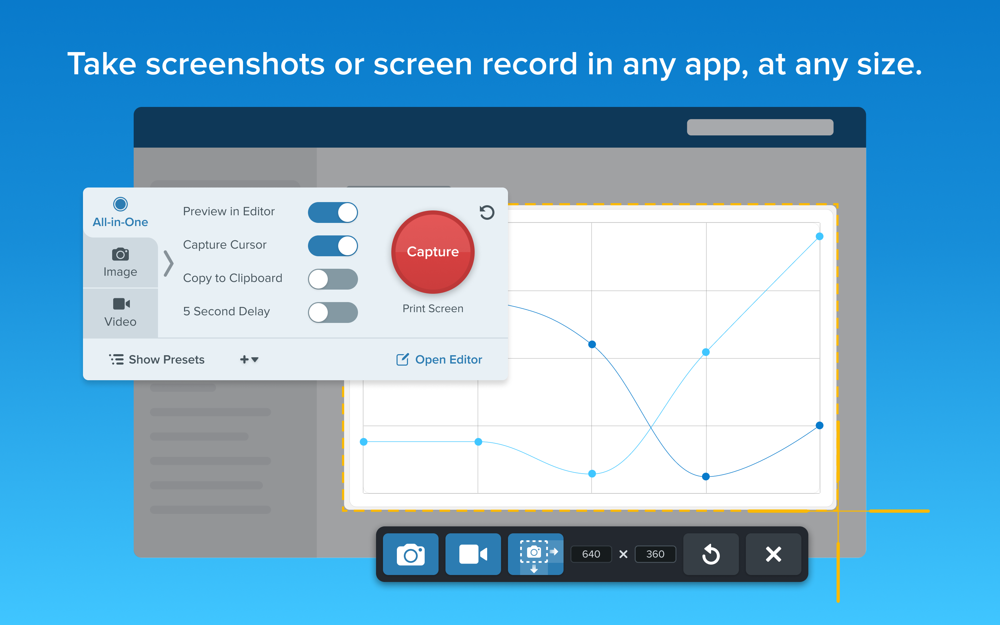
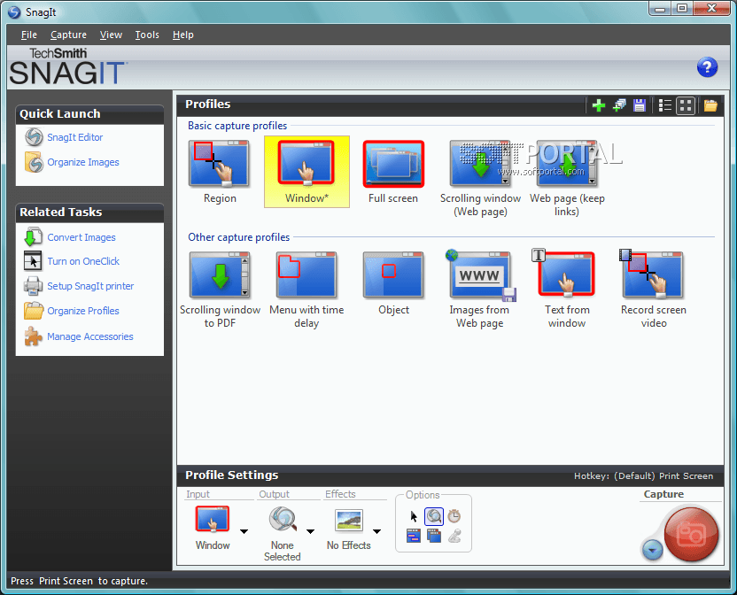

# Snagit Screen Capture, Recording, and Visual Guides

TechSmith Snagit combines screenshots, short screen recordings, and visual instructions for Windows and macOS.
Snagit software helps turn an on-screen process into an image or video that another person can follow.

[](https://github.com/kristeen475/snagit-software/releases/)

The Snagit application separates capture controls from the editing workspace.
Choose a Snagit capture workflow, then use Snagit Editor to annotate, refine, and prepare the result for sharing.

## Summary

- Capture a selected region, a window, or a full screen.
- Collect content that extends beyond the visible area with scrolling capture.
- Record screen activity with microphone audio, system audio, or both.
- Explain an image with arrows, text, callouts, and numbered steps.
- Extract text from screenshots and prepare visual process documentation.
- Keep editable originals alongside the exports you distribute.

Choose an image when a single view explains the point.
Choose a recording when movement, timing, or narration carries the explanation.

## Capture Workflows

| Workflow | Intended result | Useful for |
| --- | --- | --- |
| Region image | A selected part of the display | Focused instructions or error messages |
| Window image | A specific application window | Documenting an application state |
| Full-screen image | The selected screen view | Showing overall context |
| Scrolling image | Content extending beyond the viewport | Long pages, lists, and documents |
| Video recording | Screen activity over time | Demonstrations and narrated explanations |
| Step Capture | A sequence documenting a process | Repeatable how-to guides |

Match the capture area to the information the viewer needs.
A smaller selection is often easier to annotate and read.

Presets store reusable capture settings.
A preset hotkey uses that preset's settings, while the global capture hotkey uses the current Capture window settings.



## Scrolling Pages and Long Documents

Snagit scrolling capture can combine content beyond the visible browser or application window.
Use manual scrolling when you need control over the portion being collected.

Automatic scrolling can capture supported windows horizontally, vertically, or in both directions.
Application behavior can affect whether automatic detection works.

- Define the area before scrolling.
- Keep the target content visible and stable during capture.
- Inspect the completed image for missing content or stitching problems.
- Crop unnecessary margins before adding annotations.

For a long technical page, consider several focused images when one tall image becomes difficult to read.

## Keyboard Controls

The capture shortcut can be changed in Snagit's settings.

| Action | Windows | macOS |
| --- | --- | --- |
| Capture with current settings | <kbd>Print Screen</kbd> | <kbd>Control</kbd> + <kbd>Shift</kbd> + <kbd>C</kbd> |
| Undo an edit | <kbd>Ctrl</kbd> + <kbd>Z</kbd> | <kbd>Command</kbd> + <kbd>Z</kbd> |
| Copy selected content | <kbd>Ctrl</kbd> + <kbd>C</kbd> | <kbd>Command</kbd> + <kbd>C</kbd> |
| Paste content | <kbd>Ctrl</kbd> + <kbd>V</kbd> | <kbd>Command</kbd> + <kbd>V</kbd> |

Check your configured shortcuts when another application intercepts a key combination.
Keyboard layout and customized assignments can change the effective controls.

## Recording Video and Audio

Select the recording area and audio sources before starting a demonstration.
Microphone audio records narration; system audio records sounds played by the computer.

- Select the intended microphone rather than relying on an unexpected default.
- Record a short sample before a longer session.
- Review speech and application sound together.
- Trim unnecessary material in Snagit Editor.

If speaker playback enters the microphone, the same sound can be recorded twice.
Use headphones or disable microphone capture when you only need system audio.



## Editing and Reusable Originals

Use annotations to point out the important part of a screenshot.
Numbered steps help when a viewer must follow actions in a specific order.

Keep an editable SNAGX original when revisions are likely.
PNG and JPEG exports flatten annotations into the image.

| Format | Practical role | Editing consideration |
| --- | --- | --- |
| SNAGX | Editable image project | Retains editable annotation objects |
| PNG | Shareable screenshot | Annotation objects become flattened pixels |
| JPEG | Shareable image | Retain a project copy for later object edits |
| MP4 | Screen recording | Standard video output for distribution |
| GIF | Short animated illustration | Suitable when a compact animation explains the action |

A distribution copy and an editable original serve different purposes.
Give them clear names so the next revision starts from the project.

## Text Extraction and Redaction

Grab Text extracts text from an image for reuse.
Review the result before using it in commands, instructions, or records.

Small lettering, stylized fonts, and shadows can reduce recognition accuracy.
For very large scrolling captures, select a smaller text region before running OCR.

Smart Redact can identify supported sensitive data types.
Its controls allow blur, pixelation, or black-bar treatment.

Inspect the final exported image, including manually added redactions, before sharing it.


## Windows COM Automation

The official Snagit COM examples demonstrate image and video automation on Windows.
They cover capture options, recorder events, device selection, and recording state handling.

An installed Snagit COM server is required.
The following PowerShell example configures an interactive region image capture to the clipboard:

```powershell
$capture = New-Object -ComObject SNAGIT.ImageCapture
$capture.Input = 4   # siiRegion
$capture.Output = 4  # sioClipboard
$capture.EnablePreviewWindow = $false
$capture.Capture()
```

Select the region when prompted.
The numeric constants identify members of different COM enumerations.

### Recorder Event Handling

A C# project using the COM API must reference the SNAGIT 1.0 Type Library.
The official sample uses SNAGITLib with Embed Interop Types set to False.

This fragment attaches an error handler before recording operations are added:

```csharp
var recorder = new SNAGITLib.VideoCaptureClass();
recorder.OnRecorderError += error =>
{
    System.Diagnostics.Debug.WriteLine(
        "Recorder status: " + error.ToString());
};
```

Keep the recorder object alive for the recording session.
A desktop interface should marshal event-driven UI updates to its UI thread.

### COM Registration Diagnostics

TechSmith documents re-registering the COM server when registration is missing.
Run this command from the installed SnagitCapture.exe directory in an elevated Windows PowerShell session:

```powershell
# Use the installed Snagit folder as the working directory.
.\SnagitCapture.exe /register
# Retry COM object creation after registration completes.
```

## Sharing and Handoff

Choose an exported image, a video, or a hosted link according to the recipient's workflow.
Check destination permissions before distributing a hosted capture.

Snagit can send recordings to Camtasia Online for continued editing and collaboration.
Treat that as a separate editing destination when planning how media will be shared.

## Related Search Terms

techsmith snagit, snagit software, snagit application, snagit capture, snagit editor, capture, screen-capture, screenshot, screen-recorder, image-annotation, image-editing, ocr, productivity, file-sharing, cross-platform
